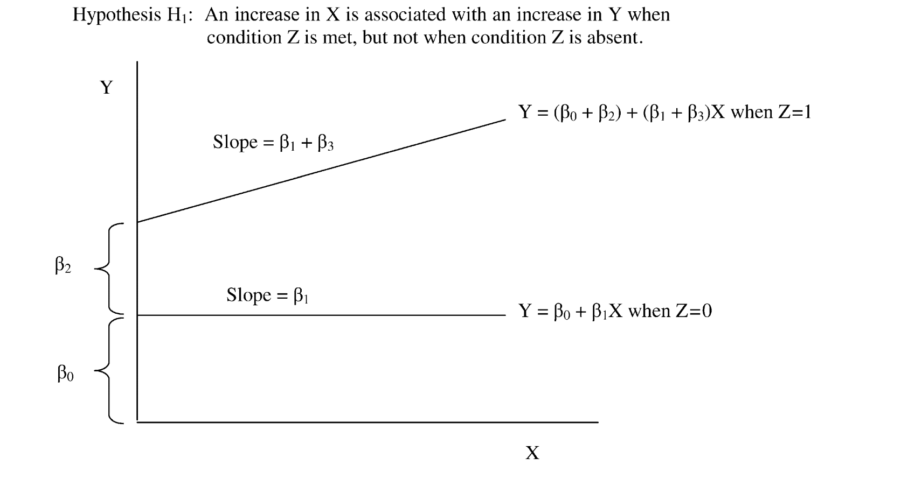

<!-- Shared format options live in _metadata.yml, so this deck's YAML carries only the title.

     Arc: a five-minute recap that reads a brms summary from week 9 block by block, and picks
     up week 9's closing question (were the lines parallel only because we assumed it?).
     Then the idea of an interaction in generic letters (x, z), on the linear predictor alone:
     a product term, the slope of x regrouped as beta 1 + beta 3 z, the Brambor et al. picture
     for a binary moderator, and the fan of lines for a continuous one. A short slide on how R
     turns a categorical variable into k - 1 dummies. Then the eight-step chapter opens with
     the substantive question and a DAG (GDP is the fork that justifies the control c), and
     walks the full model in the same letters: x, z, c. Step 7 reports four
     models in one table with LOOIC, runs loo_compare() on all four, shows expected and
     predicted values with non-parallel lines, and ends on a marginal-effects plot.

     Data: synthetic, n = 120 countries, written by the data-health chunk to
     data/week10-health.csv if missing. Story kept from the 2026 spring deck: women in
     parliament and health spending, moderated by regime type. Regime type comes twice: a
     dummy (parliamentary) and a continuous V-Dem-like index of legislative power (0 to 1).
     The dummy is a coarsened version of the index, and the true moderation runs through
     the index: health = 7 + 0.2 (gdp - 18) + 0.05 (women - 30) + 2 power
     + 0.15 (women - 30) power + N(0, 1.2). So the slope of women in parliament is 0.05 in the weakest
     legislatures and 0.20 in the strongest. Women in parliament also rises with GDP, so the
     bivariate slope is inflated.

     Stan backend: cmdstanr, as in weeks 8 and 9. All four fits are cached in
     data/week10-fit-*.rds with their LOO criterion attached.

     Time budget (90 min, no buffer): opening 3, recap 5, interactions in the linear
     predictor 10, dummy coding 4, question 2, DAG 3, steps 1 and 2 9, step 3 10, step 4 3,
     step 5 4, steps 6a and 6b 6, step 7 table 8, loo_compare 5, expected and predicted 6,
     marginal effects 6, step 8 3, wrap-up 3. Total 90.
     If behind: narrate step 4, show only the trace plot at step 6a, and say the continuous
     fan figure in one sentence. The caching slide sits in the appendix. -->

```{r}
#| label: setup
#| include: false

start_time <- Sys.time()

library(tidyverse) # wrangling and visualization
library(here) # project-root-relative paths
library(brms) # Bayesian regression via Stan
library(broom.mixed) # tidy model output
library(patchwork) # multi-panel figures

# _quarto.yml is a project-root marker, so anchor here() at the repo root.
here::i_am("website/slides/week10.qmd")

# rstan does not build against the installed StanHeaders, cmdstanr does.
options(brms.backend = "cmdstanr")

# Shared palette. Reused verbatim across slides, homework and solutions so a
# chain colour means the same thing in every artefact of the course.
col_1 <- "steelblue"
col_2 <- "#E07B39"
col_3 <- "#7B3F9E"
col_4 <- "goldenrod3"
chain_cols <- c(col_1, col_2, col_3, col_4)

# Print missing values as empty cells.
options(knitr.kable.NA = "")
regime_cols <- c(Presidential = col_1, Parliamentary = col_2)

# Median and 90 percent interval, rounded for inline use.
q3 <- function(v, digits = 2) {
  round(quantile(v, c(0.05, 0.5, 0.95)), digits)
}

# DAG helper, as in week 9: nodes(name, x, y, label), edges(from, to).
# Arrows are shortened at both ends so they stop at the node labels.
draw_dag <- function(nodes, edges, title = NULL, shrink = 0.28) {
  segs <- edges |>
    left_join(nodes, by = c("from" = "name")) |>
    left_join(nodes, by = c("to" = "name"), suffix = c("", "end")) |>
    mutate(
      len = sqrt((xend - x)^2 + (yend - y)^2),
      dx = (xend - x) / len,
      dy = (yend - y) / len,
      x = x + shrink * dx,
      y = y + shrink * dy,
      xend = xend - shrink * dx,
      yend = yend - shrink * dy
    )
  ggplot() +
    geom_segment(
      data = segs,
      aes(x = x, y = y, xend = xend, yend = yend),
      arrow = arrow(length = unit(0.22, "cm"), type = "closed"),
      linewidth = 0.9,
      colour = "grey25"
    ) +
    geom_label(
      data = nodes,
      aes(x = x, y = y, label = label),
      size = 4,
      fill = "white",
      fontface = "bold",
      label.padding = unit(0.4, "lines")
    ) +
    coord_cartesian(clip = "off") +
    scale_x_continuous(expand = expansion(add = 0.4)) +
    scale_y_continuous(expand = expansion(add = 0.3)) +
    theme_void() +
    labs(title = title)
}
```

```{r}
#| label: data-health
#| include: false

# Synthetic data with a known truth. Written once and committed, so the deck
# renders identically everywhere.
health_csv <- here("website", "slides", "data", "week10-health.csv")
if (!file.exists(health_csv)) {
  set.seed(2026)
  n_countries <- 120
  tibble(
    country = sprintf("C%03d", 1:n_countries),
    gdp_pc = round(rnorm(n_countries, 18, 7), 1),
    parliamentary = rbinom(n_countries, 1, 0.55)
  ) |>
    mutate(
      women_parl = round(
        pmin(pmax(20 + 0.6 * gdp_pc + rnorm(n_countries, 0, 7), 3), 60),
        1
      ),
      leg_power = round(
        plogis(-1.6 + 3.2 * parliamentary + rnorm(n_countries, 0, 0.6)),
        2
      ),
      health_spend = round(
        7 +
          0.2 * (gdp_pc - 18) +
          0.05 * (women_parl - 30) +
          2 * leg_power +
          0.15 * (women_parl - 30) * leg_power +
          rnorm(n_countries, 0, 1.2),
        1
      )
    ) |>
    write_csv(health_csv)
}

health <- read_csv(health_csv, show_col_types = FALSE) |>
  mutate(
    regime = if_else(parliamentary == 1, "Parliamentary", "Presidential"),
    regime = fct_relevel(regime, "Presidential")
  )
n_countries <- nrow(health)

power_gap <- c(
  max(health$leg_power[health$parliamentary == 0]),
  min(health$leg_power[health$parliamentary == 1])
)
```

## Week 10 goals {#sec-week10-goals .smaller}

::: notes
Read the goals aloud and come back to them at the end.
Goals 3 and 5 matter most for the exam.
:::

By the end of today, you will be able to:

1. Explain what an **interaction term** does: the slope of one predictor depends on another, the **moderator**.
2. Say how R turns a **categorical variable** into dummy variables around a **reference category**.
3. Write down and fit an **interaction model**, and read the slope of a predictor at each value of its moderator.
4. Compare several models in one **regression table** and with `loo_compare()`.
5. Show a conditional effect in a **figure**: expected and predicted values, and a **marginal-effects plot**.

## Today {#sec-today .smaller}

::: notes
One minute.
The last line is the bridge from week 9.
:::

1. **Recap:** reading a `brms` summary
2. **Interactions** in the linear predictor
3. **Categories** become dummy variables
4. **Our question and the eight steps**: a DAG, one interaction model and three to compare it with
5. **Reporting:** a table of four models, expected and predicted values, a marginal-effects plot

. . .

::: {.callout-note}
**Last week, every predictor had one slope for everyone.**
Today the slope of one predictor may change with the value of another.
:::

## Where today fits {#sec-where-today-fits .smaller}

Last week: several predictors, each with **one** slope.
Today: a slope that **depends** on another predictor, so steps 3 and 7 change most.



::: notes
Point at steps 3 and 7.
Step 3 gets a product term and one more prior, step 7 now has to report a slope that is not one number.
:::

# Recap {#sec-recap}

## Reading a `brms` summary {#sec-recap-summary .smaller}

```{r}
#| label: recap-fit
#| include: false

# The fit from the week 9 deck, read from its cache, never refitted.
fit_week09 <- readRDS(
  here("website", "slides", "data", "week09-fit-gender.rds")
)
```

::: notes
Five minutes, with the room doing the reading.
This is the model from last week: income on schooling (centred at 12 years) and a woman dummy.
Walk top to bottom: formula and data, then the draws, then the Regression Coefficients block, then Further Distributional Parameters, then the convergence columns.
Ask a student for each question before answering it.
:::

::: {.small}
```{r}
#| label: recap-summary
#| code-fold: false

summary(fit_week09)
```
:::

> **Q:** Where is the schooling slope, what is its 95 percent credible interval, and did the chains converge?

## What each block tells us {#sec-recap-blocks .smaller}

::: notes
Read the table row by row and point at the output again.
Then the bridge: the woman row shifts the intercept only.
Ask: does an extra year of schooling pay the same for women and men in this model?
Yes, by assumption, because there is one edu12 row.
That assumption is what today relaxes.
:::

::: {.small}
| Block | What it says | Step |
|---|---|---|
| `Formula`, `Data`, `Draws` | The model we wrote down, how many observations, how many posterior draws | 3, 5 |
| `Regression Coefficients` | One row per coefficient: posterior mean, posterior SD, 95 percent credible interval | 7 |
| `Further Distributional Parameters` | $\sigma$, the residual standard deviation | 7 |
| `Rhat`, `Bulk_ESS`, `Tail_ESS` | Did the chains converge, and how many effectively independent draws | 6a |

: The blocks of a `brms` summary, what each says and the workflow step that uses it. {#tbl-recap-blocks}
:::

. . .

There is **one** schooling slope, so the model says schooling pays off **equally** for women and men.
That was an assumption, not a finding.

> **Q:** How would we let the data tell us whether the slope differs?

# Interactions {#sec-interactions}

## A product term in the linear predictor {#sec-product-term .smaller}

::: notes
Generic letters first, our own story comes with the eight steps.
Say: a model without an interaction assumes the slope is the same everywhere, which is a strong assumption.
Only the linear predictor here, the full model comes at step 3.
The product is just one more column: x times z, with its own coefficient.
Then regroup: collect everything that multiplies x.
The slope of x is now beta 1 plus beta 3 times z.
Ask: what is the slope of x when z is 0?
Beta 1, and only then.
:::

Sometimes the association between a predictor $x$ and the outcome $y$ is **not constant**: it changes with a third variable $z$, the **moderator**.
Last week, each predictor got its own term.
To let $z$ change the slope of $x$, we add their **product**, an **interaction**:

$$
\mu_i = \alpha + \beta_1 x_i + \beta_2 z_i + \beta_3 \, x_i z_i
$$ {#eq-interaction}

. . .

Collect the terms that multiply $x_i$:

$$
\mu_i = (\alpha + \beta_2 z_i) + (\beta_1 + \beta_3 z_i) \, x_i
$$ {#eq-regrouped}

. . .

- The **slope of $x$** is $\beta_1 + \beta_3 z_i$: it depends on $z$.
- $\beta_1$ is the slope of $x$ **where $z = 0$**, and only there.
- $\beta_3$ is how much the slope of $x$ changes **per unit of $z$**.

## A binary moderator: two lines {#sec-binary-moderator .smaller}

::: notes
The classic picture, from the article everyone cites on interactions.
They write beta 0 for what we call alpha.
Point: beta 2 moves the intercept, beta 3 changes the slope.
With z = 0 the second and third terms of @eq-interaction vanish, with z = 1 they add.
:::

{#fig-brambor width="80%"}

## A continuous moderator: many lines {#sec-continuous-moderator .smaller}

```{r}
#| label: fan-numbers
#| include: false

# Illustrative coefficients, no data.
fan_beta_1 <- 0.5
fan_beta_3 <- 0.8
```

::: notes
Same algebra, but z can take any value, so there is one line for every value of z.
Three lines drawn here, at low, middle and high z.
Parallel lines would mean no interaction, a fan means beta 3 is not zero.
If behind: say this in one sentence and move on.
:::

When $z$ is continuous, @eq-regrouped gives **one line for every value of $z$**, and the slope $\beta_1 + \beta_3 z$ changes smoothly.

```{r}
#| label: fig-fan
#| fig-cap: "Expected outcome against x at three values of a continuous moderator z, with
#|   illustrative values beta 1 = 0.5 and beta 3 = 0.8. The slope of x is 0.5 - 0.8 = -0.3 at
#|   z = -1, 0.5 at z = 0 and 1.3 at z = 1. A fan instead of parallel lines is what an
#|   interaction looks like."
#| fig-height: 3.2
#| dpi: 500

expand_grid(x = c(-2, 2), z = c(-1, 0, 1)) |>
  mutate(
    mu = fan_beta_1 * x + fan_beta_3 * x * z,
    z_label = fct_inorder(
      case_match(z, -1 ~ "z = -1", 0 ~ "z = 0", 1 ~ "z = 1")
    )
  ) |>
  ggplot(aes(x = x, y = mu, colour = z_label)) +
  geom_line(linewidth = 1.2) +
  scale_colour_manual(values = c(col_1, col_4, col_2)) +
  theme_classic() +
  labs(
    x = "x",
    y = "Expected outcome",
    colour = NULL,
    title = "One slope for every value of z"
  )
```

## Categories become dummy variables {#sec-categorical .smaller}

```{r}
#| label: class-example
#| include: false

people <- tibble(
  person = c("Ana", "Ben", "Cem", "Dana", "Eli"),
  class = factor(
    c("working", "middle", "upper", "working", "middle"),
    levels = c("working", "middle", "upper")
  )
)
```

::: notes
Regime type is a category, and so are many moderators.
A model only multiplies numbers, so R turns a category into 1 and 0 columns behind the scenes.
Walk one row: Cem is upper class, so classupper is 1 and classmiddle is 0.
Working class has no column: it is the reference, where both dummies are 0.
Every coefficient of a dummy is then a difference from the reference category.
:::

A model multiplies numbers, so R turns a categorical variable into **dummy variables** (1 or 0) before it fits.
Take social class with three categories:

:::: {.columns}

::: {.column width="40%"}
::: {.small}
```{r}
#| label: class-data
#| code-fold: false

people
```
:::
:::

::: {.column width="60%"}
::: {.small}
```{r}
#| label: class-dummies
#| code-fold: false

model.matrix(~ class, data = people) |>
  as_tibble()
```
:::
:::

::::

. . .

- $k$ categories become **$k - 1$ dummies**, here two.
- The category without a dummy is the **reference category**: by default the first level, here working class.
- Each dummy's coefficient is a **difference from the reference**.

::: {.callout-tip}
**The reference category is your choice.**
Set it on purpose with `fct_relevel()`, so the comparisons answer your question.
:::

# The eight steps {#sec-eight-steps}

## Does who sits in parliament matter more in parliamentary systems? {#sec-question .smaller}

::: notes
Today's story, kept from last term: synthetic data, so the truth is known.
The theory is what matters: in parliamentary systems the government depends on the legislature and controls the budget through it, so who sits in parliament should matter more for spending.
Map the story onto the letters of the last section: x, z, and one more, c, a control.
:::

> **Does the association between women in parliament and health spending depend on regime type?**

. . .

**Legislative composition theory**: in parliamentary systems the legislature controls the budget, so who sits in parliament should translate into spending more directly than in presidential systems, where power is divided between branches.

. . .

:::: {.columns}

::: {.column width="55%"}
In the language of the last section:

- $y$: health spending, in percent of GDP
- $x$: women in parliament, in percent of seats
- $z$: regime type, the **moderator**
- $c$: GDP per capita, a **control**, in thousand USD
:::

::: {.column width="45%"}
::: {.callout-note}
**Our data: `r n_countries` countries, synthetic.**
Regime type comes twice: a dummy (parliamentary or presidential) and a continuous index of legislative power from 0 to 1.
:::
:::

::::

## Our theory as a DAG {#sec-dag .smaller}

::: notes
As in week 9: draw the theory before writing the model.
Walk the three solid arrows and ask for the story behind each.
GDP is a fork: richer countries elect more women and spend more on health.
Leave it out and the model credits GDP's influence to women in parliament.
Walk the dashed arrow last: it points at an arrow, not at a variable, and that is what moderation means.
Regime type still enters the model on its own as well (beta 2), because an interaction keeps its constitutive terms.
Then the callout: the dashed arrow is a shorthand, not part of the DAG rules from week 9.
:::

:::: {.columns}

::: {.column width="55%"}
```{r}
#| label: fig-dag
#| fig-cap: "Our theory as a DAG. GDP per capita influences both women in parliament and
#|   health spending. Regime type, the dashed arrow, changes how strongly women in parliament
#|   is associated with health spending: it moderates that arrow."
#| fig-height: 3.4
#| fig-width: 5.4
#| dpi: 500

draw_dag(
  nodes = tibble(
    name = c("C", "X", "Y", "Z"),
    x = c(1.5, 0, 3, 1.5),
    y = c(1.5, 0, 0, -1.5),
    label = c("GDP per\ncapita (c)", "Women in\nparliament (x)", "Health\nspending (y)", "Regime\ntype (z)")
  ),
  edges = tibble(from = c("C", "C", "X"), to = c("X", "Y", "Y")),
  title = "Our theory",
  shrink = 0.75
) +
  annotate(
    "segment",
    x = 1.5,
    xend = 1.5,
    y = -1.05,
    yend = -0.08,
    arrow = arrow(length = unit(0.22, "cm"), type = "closed"),
    linewidth = 0.9,
    linetype = "dashed",
    colour = "grey25"
  ) +
  theme(plot.margin = margin(5, 10, 5, 45))
```
:::

::: {.column width="45%"}
- **GDP is a fork**, a confounder: richer countries elect more women **and** spend more on health.
- Leaving it out credits its influence to women in parliament, so GDP is a **control**.
- Regime type points at the **arrow** from women in parliament to health spending: it is the moderator $z$.
:::

::::

. . .

::: {.callout-note}
**The dashed arrow is a common shorthand, not part of a DAG's rules.**
A DAG only says whether variables are related, so strictly it cannot show that $z$ changes the strength of an arrow.
In the model, the dashed arrow becomes the product term $x_i z_i$ at step 3, alongside $z_i$ itself.
:::

## Step 1: Estimand {#sec-step1 .smaller}

::: notes
The estimand is now a slope per regime type, not one slope.
The difference between the two slopes is the interaction.
Same GDP, because GDP is the fork in @fig-dag.
Then the warning, as last week.
:::

The research question:

> Is the association between women in parliament and health spending stronger in parliamentary systems?

. . .

What precisely do we want to learn?

> How much higher is expected health spending in a country with one more percentage point of women in parliament, **separately for presidential and parliamentary systems**, among countries with the same GDP?

. . .

Two **conditional** partial associations, and their **difference**.
GDP is held constant because it is the fork in @fig-dag.

. . .

::: {.callout-warning}
**A conditional association is still not a causal effect.**
Countries where women hold more seats may differ in other ways that also drive spending.
:::

## Step 2: The data {#sec-step2 .smaller}

::: notes
Our first look, by regime type.
Parliamentary systems have stronger legislatures by construction.
Ask: what would you expect to see in the scatter plot if the theory holds?
Steeper lines among parliamentary systems.
:::

::: {.small}
```{r}
#| label: tbl-by-regime
#| tbl-cap: "Number of countries and mean values by regime type. Legislative power is an index
#|   from 0 (weakest) to 1 (strongest legislature). Health spending is in percent of GDP, GDP
#|   per capita in thousand USD."
#| code-fold: false

health |>
  group_by(regime) |>
  summarise(
    n = n(),
    women = mean(women_parl),
    power = mean(leg_power),
    gdp = mean(gdp_pc),
    spend = mean(health_spend)
  ) |>
  knitr::kable(
    digits = 1,
    col.names = c("Regime", "Countries", "Women (%)", "Legislative power", "GDP per capita", "Health spending (%)")
  )
```
:::

> **Q:** Parliamentary systems spend more on average.
> Does that tell us whether spending rises more steeply with women in parliament there?

## Step 2: Two slopes? {#sec-step2-scatter .smaller}

::: notes
A difference in means is not a difference in slopes.
Here the lines differ in both, which is what the interaction model will estimate.
:::

```{r}
#| label: fig-scatter
#| fig-cap: "Health spending against women in parliament, one point per country, with one
#|   least-squares line per regime type drawn for the eye. The line for parliamentary systems
#|   is steeper."
#| fig-height: 3.8
#| dpi: 500

ggplot(health, aes(x = women_parl, y = health_spend, colour = regime)) +
  geom_point(alpha = 0.6, size = 1.6) +
  geom_smooth(method = "lm", se = FALSE, linewidth = 1.2) +
  scale_colour_manual(values = regime_cols) +
  theme_classic() +
  labs(
    x = "Women in parliament (%)",
    y = "Health spending (% GDP)",
    colour = NULL,
    title = "Steeper where parliament holds the budget?"
  )
```

## Step 2: Common support {#sec-common-support .smaller}

::: notes
An interaction compares slopes, so each slope needs data to be learned from.
Left: both regime types cover much the same range of women in parliament, good.
Right: the index splits cleanly by regime, with a gap in the middle.
No country has legislative power between the two groups, so the continuous model will interpolate there.
Brambor and colleagues: check this before interpreting any interaction.
:::

An interaction compares slopes, so we need **data on $x$ at every value of $z$** we talk about: **common support**.

```{r}
#| label: fig-common-support
#| fig-cap: "Left, women in parliament by regime type: the two groups cover a similar range, so
#|   both slopes can be learned from data. Right, the legislative power index by regime type:
#|   no country lies between the two groups, so statements about that middle range rest on the
#|   model, not on data."
#| fig-height: 2.8
#| fig-width: 10
#| dpi: 500

support_women <- ggplot(health, aes(x = women_parl, fill = regime)) +
  geom_density(alpha = 0.5, colour = NA) +
  scale_fill_manual(values = regime_cols) +
  theme_classic() +
  labs(
    x = "Women in parliament (%)",
    y = "Density",
    fill = NULL,
    title = "Women in parliament overlap"
  )
support_power <- ggplot(health, aes(x = leg_power, fill = regime)) +
  geom_histogram(binwidth = 0.05, boundary = 0, alpha = 0.5, colour = NA) +
  scale_fill_manual(values = regime_cols) +
  theme_classic() +
  labs(
    x = "Legislative power (0 to 1)",
    y = "Countries",
    fill = NULL,
    title = "Legislative power splits by regime"
  )
support_women + support_power + plot_layout(guides = "collect")
```

> **Q:** At which values of legislative power would you trust a statement about the slope of women in parliament least?

## Step 3: Formal model {#sec-step3 .smaller}

::: notes
The same template as weeks 8 and 9: outcome distribution, then linear predictor.
The linear predictor is @eq-interaction from the concept section, plus the control c.
Centring as last week: women at 30 percent and GDP at 18 thousand, so alpha is a presidential country with 30 percent women and average-ish GDP, which we can defend a prior for.
And beta 1 is the slope of women in parliament in presidential systems, where z is 0.
:::

**1. Outcome distribution.**
Health spending is drawn from a normal distribution with mean $\mu_i$ and standard deviation $\sigma$:

$$
y_i \sim \mathcal{N}(\mu_i, \sigma)
$$ {#eq-likelihood}

**2. Linear predictor.**
@eq-interaction, plus the control: the slope of women in parliament may differ by regime type, holding GDP constant.

$$
\mu_i = \alpha + \beta_1 x_i + \beta_2 z_i + \beta_3 \, x_i z_i + \beta_4 c_i
$$ {#eq-linear-predictor}

::: {.small}
- $y_i$ is the health spending of country $i$, in percent of GDP.
- $x_i$ is its share of women in parliament **minus 30**, in percentage points.
- $z_i$ is 1 for a parliamentary and 0 for a presidential system, the **reference category**.
- $c_i$ is its GDP per capita **minus 18**, in thousand USD.

Both are **centred**, as in week 9: $x_i = c_i = 0$ is a typical country, not one with no women and no income.
:::

Read $\sim$ as **is drawn from** (random) and $=$ as **is defined as** (fixed).

## Step 3: Two lines in one model {#sec-two-lines .smaller}

::: notes
Plug in 0 and 1 for z, as in @fig-brambor.
Read each line out loud.
Ask: which coefficient is the answer to our estimand?
Beta 1 for presidential, beta 1 plus beta 3 for parliamentary, and beta 3 for the difference.
:::

Set the dummy to 0 or 1 in @eq-linear-predictor:

::: {.small}
| Regime | $z_i$ | Intercept | Slope of women in parliament |
|---|:-:|---|---|
| Presidential | 0 | $\alpha$ | $\beta_1$ |
| Parliamentary | 1 | $\alpha + \beta_2$ | $\beta_1 + \beta_3$ |

: The linear predictor of @eq-linear-predictor for each regime type, holding GDP constant. {#tbl-two-lines}
:::

. . .

- $\beta_1$: the slope of women in parliament in **presidential** systems.
- $\beta_3$: how much **steeper** (or flatter) that slope is in **parliamentary** systems.
- $\beta_2$: the regime gap in spending **at 30 percent women** only, because $x_i = 0$ there.

. . .

::: {.callout-warning}
**With an interaction, no single coefficient is "the" association of women in parliament with spending.**
$\beta_1$ alone is the slope where the moderator is 0, here presidential systems.
:::

## Step 3: The posterior {#sec-step3-posterior .smaller}

::: notes
Read the left side first: these are all the unknowns.
Count them out loud: six parameters, so six priors.
The interaction costs exactly one more parameter.
:::

**3. Posterior, proportional form.**

$$
P(\alpha, \beta_1, \beta_2, \beta_3, \beta_4, \sigma \mid \mathbf{y}, \mathbf{X}) \propto \mathcal{L}(\alpha, \beta_1, \beta_2, \beta_3, \beta_4, \sigma \mid \mathbf{y}, \mathbf{X}) \times P(\alpha) \, P(\beta_1) \, P(\beta_2) \, P(\beta_3) \, P(\beta_4) \, P(\sigma)
$$ {#eq-posterior}

- $\mathbf{y}$ is the health spending column, and $\mathbf{X}$ holds the predictor columns $\mathbf{x}$, $\mathbf{z}$ and $\mathbf{c}$, `r n_countries` rows each.
- The likelihood $\mathcal{L}$ comes from @eq-likelihood and @eq-linear-predictor, applied to every country.

. . .

The left side lists every unknown: **six parameters, so six priors** to choose.

## Step 3: The complete model {#sec-model-card .smaller}

::: notes
The card is the course format for step 3.
Read it top to bottom: the outcome, its mean, then one prior per unknown.
Open the interaction prior live, the rest are for reading at home.
:::

$$
\begin{aligned}
y_i &\sim \mathcal{N}(\mu_i, \sigma) && \text{outcome distribution} \\
\mu_i &= \alpha + \beta_1 x_i + \beta_2 z_i + \beta_3 \, x_i z_i + \beta_4 c_i && \text{linear predictor} \\
\alpha &\sim \mathcal{N}(7, 3) && \text{prior} \\
\beta_1, \beta_3, \beta_4 &\sim \mathcal{N}(0, 0.25) && \text{prior} \\
\beta_2 &\sim \mathcal{N}(0, 2) && \text{prior} \\
\sigma &\sim \text{Exponential}(0.5) && \text{prior}
\end{aligned}
$$ {#eq-model}

Every prior is argued on the scale of the outcome, percent of GDP:

::: {.small}
<details>
<summary>The intercept, $\alpha \sim \mathcal{N}(7, 3)$</summary>

::: {.callout-note}
**Expected spending of a presidential country with 30 percent women and a GDP of 18 thousand USD.**
Public health spending typically lies between a few and a dozen percent of GDP.
With 95 percent probability the prior lies between 1 and 13.
:::

</details>

<details>
<summary>The slopes, $\beta_1, \beta_3, \beta_4 \sim \mathcal{N}(0, 0.25)$</summary>

::: {.callout-note}
**Centred on no association, because the sign is what we want to learn.**
95 percent of the prior lies between $-0.5$ and $+0.5$ per percentage point of women in parliament (or per thousand USD).
Ten points more women shifting spending by five points of GDP would already be enormous.
$\beta_3$, the difference between two slopes, lives on the same scale, centred on **no moderation**.
:::

</details>

<details>
<summary>The regime gap, $\beta_2 \sim \mathcal{N}(0, 2)$</summary>

::: {.callout-note}
**Centred on no gap, open in both directions.**
95 percent of the prior lies between $-4$ and $+4$ points of GDP at 30 percent women.
:::

</details>

<details>
<summary>The residual standard deviation, $\sigma \sim \text{Exponential}(0.5)$</summary>

::: {.callout-note}
**Positive, and typically around 2.**
An exponential with rate 0.5 has a mean of 2 points of GDP, so countries typically lie that far from their expected spending.
:::

</details>
:::

## Step 3: Four models to compare {#sec-four-models .smaller}

::: notes
We fit three more models, so step 7 can show what the interaction adds.
The bivariate model is week 8, the additive one is week 9.
The last one swaps the dummy for a continuous V-Dem-style index of how much power the legislature has, from 0 to 1.
Same logic, same priors: beta 2 is now the gap between the weakest and the strongest legislature.
:::

::: {.small}
| Model | Linear predictor $\mu_i =$ | $z_i$ is | New idea |
|---|---|---|---|
| Bivariate | $\alpha + \beta_1 x_i$ | | week 8 |
| Additive | $\alpha + \beta_1 x_i + \beta_2 z_i + \beta_4 c_i$ | parliamentary (0/1) | a control, week 9 |
| Interaction, dummy | $\alpha + \beta_1 x_i + \beta_2 z_i + \beta_3 \, x_i z_i + \beta_4 c_i$ | parliamentary (0/1) | the slope differs by regime |
| Interaction, continuous | $\alpha + \beta_1 x_i + \beta_2 z_i + \beta_3 \, x_i z_i + \beta_4 c_i$ | legislative power (0 to 1) | the slope changes with legislative power |

: The four linear predictors fitted today. All share the outcome distribution of @eq-likelihood and the priors of @eq-model. The two interaction models differ only in what the moderator $z_i$ measures. {#tbl-four-models}
:::

. . .

- **Legislative power** is an index from 0 (weakest) to 1 (strongest legislature).
- In the continuous model, the slope of women in parliament is $\beta_1 + \beta_3 z_i$: **a different slope for every value** of the index.

## Step 4: Prior predictive check {#sec-step4 .smaller}

::: notes
Narrate if behind.
Lines are average worlds, one per prior draw, GDP held at 18.
The lines in the two panels need not be parallel: the prior on beta 3 allows the slope to differ.
A few lines dip below zero at the extremes, which is mild: the data will overrule them.
:::

```{r}
#| label: fig-prior-lines
#| fig-cap: "Fifty lines per regime type drawn from the priors of the dummy interaction model,
#|   GDP held at 18 thousand USD. The priors allow rising and falling lines and different slopes
#|   in the two regime types. A few lines dip below zero spending at the extremes, so the priors
#|   are generous, but no line is absurd."
#| fig-height: 3.4
#| dpi: 500

set.seed(2026)
tibble(
  draw = 1:50,
  alpha = rnorm(50, 7, 3),
  beta_1 = rnorm(50, 0, 0.25),
  beta_2 = rnorm(50, 0, 2),
  beta_3 = rnorm(50, 0, 0.25)
) |>
  expand_grid(women_parl = c(10, 50), parliamentary = c(0, 1)) |>
  mutate(
    women30 = women_parl - 30,
    mu = alpha + beta_1 * women30 + beta_2 * parliamentary +
      beta_3 * women30 * parliamentary,
    regime = if_else(parliamentary == 1, "Parliamentary", "Presidential")
  ) |>
  ggplot(aes(x = women_parl, y = mu, group = draw)) +
  geom_hline(yintercept = 0, linetype = "dashed", colour = "grey50") +
  geom_line(colour = col_3, alpha = 0.3) +
  facet_wrap(~ fct_relevel(regime, "Presidential")) +
  theme_classic() +
  labs(
    x = "Women in parliament (%)",
    y = "Expected health spending (% GDP)",
    title = "Average worlds our priors consider possible"
  )
```

## Step 5: Fit the interaction model {#sec-step5 .smaller}

::: notes
The first line centres the two predictors, the columns x and c of the card.
The star in women30 * parliamentary is shorthand: brms expands it to women30 + parliamentary + women30:parliamentary.
The colon term is the product, and it gets its own prior.
0 + Intercept keeps the intercept at the centring point, so the prior on alpha means what the card says.
:::

::: {.small}
```{r}
#| label: fit-dummy
#| output: false
#| code-fold: false

health <- health |>
  mutate(women30 = women_parl - 30, gdp18 = gdp_pc - 18) # centre

shared_priors <- c(
  prior(normal(7, 3), class = "b", coef = "Intercept"),
  prior(normal(0, 0.25), class = "b", coef = "women30"),
  prior(exponential(0.5), class = "sigma")
)

fit_dummy <- brm(
  health_spend ~ 0 + Intercept + women30 * parliamentary + gdp18,
  data = health,
  prior = c(
    shared_priors,
    prior(normal(0, 2), class = "b", coef = "parliamentary"),
    prior(normal(0, 0.25), class = "b", coef = "women30:parliamentary"),
    prior(normal(0, 0.25), class = "b", coef = "gdp18")
  ),
  seed = 2026,
  refresh = 0,
  file = here("website", "slides", "data", "week10-fit-dummy"),
  file_refit = "on_change"
)
```
:::

## Step 5: Three models to compare {#sec-step5-others .smaller}

::: notes
Same data, same priors, only the formula changes.
Point at the formulas: one term, two terms, a different moderator.
The LOO criterion is stored with each fit for step 7.
:::

::: {.small}
```{r}
#| label: fit-others
#| output: false
#| code-fold: false

fit_bivariate <- brm(
  health_spend ~ 0 + Intercept + women30,
  data = health, prior = shared_priors, seed = 2026, refresh = 0,
  file = here("website", "slides", "data", "week10-fit-bivariate"), file_refit = "on_change"
)

fit_additive <- brm(
  health_spend ~ 0 + Intercept + women30 + parliamentary + gdp18,
  data = health, seed = 2026, refresh = 0,
  prior = c(shared_priors, prior(normal(0, 2), class = "b", coef = "parliamentary"),
            prior(normal(0, 0.25), class = "b", coef = "gdp18")),
  file = here("website", "slides", "data", "week10-fit-additive"), file_refit = "on_change"
)

fit_continuous <- brm(
  health_spend ~ 0 + Intercept + women30 * leg_power + gdp18,
  data = health, seed = 2026, refresh = 0,
  prior = c(shared_priors, prior(normal(0, 2), class = "b", coef = "leg_power"),
            prior(normal(0, 0.25), class = "b", coef = "women30:leg_power"),
            prior(normal(0, 0.25), class = "b", coef = "gdp18")),
  file = here("website", "slides", "data", "week10-fit-continuous"), file_refit = "on_change"
)
```
:::

```{r}
#| label: add-loo
#| include: false

fit_bivariate <- add_criterion(fit_bivariate, "loo")
fit_additive <- add_criterion(fit_additive, "loo")
fit_dummy <- add_criterion(fit_dummy, "loo")
fit_continuous <- add_criterion(fit_continuous, "loo")
```

## Step 6a: MCMC diagnostics {#sec-step6a .smaller}

```{r}
#| label: diagnostics-numbers
#| include: false

all_fits <- list(fit_bivariate, fit_additive, fit_dummy, fit_continuous)
draw_checks <- map(all_fits, \(fit) {
  posterior::summarise_draws(fit, "rhat", "ess_bulk", "ess_tail") |>
    filter(str_starts(variable, "b_") | variable == "sigma")
}) |>
  bind_rows()
max_rhat <- max(draw_checks$rhat)
min_ess <- min(draw_checks$ess_bulk, draw_checks$ess_tail)
n_divergent <- map_dbl(all_fits, \(fit) {
  nuts_params(fit) |> filter(Parameter == "divergent__") |> pull(Value) |> sum()
}) |>
  sum()
```

::: notes
Week 7's rules, applied to the dummy interaction model.
Trace plots: the four chains overlap and wander around the same region.
In the summary, read only the last three columns for now.
The interaction row is new: women30:parliamentary.
If behind, show the trace plot and read the sentence at the bottom.
:::

:::: {.columns}

::: {.column width="40%"}
```{r}
#| label: fig-trace
#| fig-cap: "Trace plots for the dummy interaction model, four chains per parameter. The chains
#|   overlap and wander around the same region."
#| fig-height: 4.2
#| fig-width: 4.4
#| dpi: 500

mcmc_plot(fit_dummy, type = "trace", facet_args = list(ncol = 2)) +
  scale_colour_manual(values = chain_cols) +
  theme_classic() +
  theme(legend.position = "none", strip.text = element_text(size = 7))
```
:::

::: {.column width="60%"}
::: {.xsmall}
```{r}
#| label: summary-diagnostics
#| code-fold: false

summary(fit_dummy)
```
:::
:::

::::

Across all four models: largest R-hat `r sprintf("%.3f", max_rhat)`, smallest ESS `r round(min_ess)`, `r n_divergent` divergent transitions, so **no evidence of non-convergence**.

## Step 6b: Posterior predictive check {#sec-step6b .smaller}

::: notes
Ask the question before pointing at anything.
The pale lines follow the dark one closely.
As last week, a density check sees the distribution as a whole, so it says little about whether the slopes differ.
That is a job for step 7.
:::

```{r}
#| label: fig-ppc
#| fig-cap: "Posterior predictive check for the dummy interaction model. The dark line is the
#|   observed distribution of health spending, the pale lines are datasets generated by the
#|   fitted model. The generated data reproduce the location, spread and shape of the observed
#|   data."
#| fig-height: 3.2
#| dpi: 500

set.seed(2026)
pp_check(fit_dummy, ndraws = 50) +
  theme_classic() +
  labs(x = "Health spending (% GDP)", title = "Data the model generates")
```

> **Q:** Does the model generate data that look like ours?

# Step 7: Reporting {#sec-step7}

## One table, four models {#sec-tidy-helper .smaller}

::: notes
The week 9 pipeline, wrapped in a function so we write it once and use it four times.
Nothing new inside: tidy, mutate, select, the interval as text.
New: estimate and interval in one cell, so four models fit across a slide.
On the next slide, bind_rows stacks the four tables and pivot_wider spreads them into one column per model.
Then the LOOIC row: looic is minus two times the ELPD from last week, so here lower is better.
:::

The week 9 pipeline, written once as a function and applied to every model:

::: {.small}
```{r}
#| label: tidy-helper
#| code-fold: false

tidy_model <- function(fit) {
  looic <- fit$criteria$loo$estimates["looic", ]
  tidy(fit, conf.level = 0.9) |>
    mutate(
      cell = sprintf("%.2f [%.2f, %.2f]", estimate, conf.low, conf.high)
    ) |>
    select(term, cell) |>
    add_row(
      term = "LOOIC",
      cell = sprintf("%.1f (SE %.1f)", looic["Estimate"], looic["SE"])
    )
}
```
:::

- `cell` holds the posterior mean and the 90 percent credible interval as text.
- **LOOIC** $= -2 \times$ ELPD from week 9, so **lower is better**, with its standard error.

## Stack and spread {#sec-stack-spread .smaller}

::: notes
bind_rows stacks the four small tables, with a column saying which model each row came from.
pivot_wider spreads that column into one column per model, matched by term.
A term a model does not have stays empty.
case_match gives the terms readable names, and the last line moves the residual SD and LOOIC to the bottom.
:::

`bind_rows()` stacks the four tables, `pivot_wider()` gives each model its own column:

::: {.small}
```{r}
#| label: tab-models
#| code-fold: false

tab_models <- list(
  Bivariate = fit_bivariate,
  Additive = fit_additive,
  Dummy = fit_dummy,
  Continuous = fit_continuous
) |>
  map(tidy_model) |>
  bind_rows(.id = "model") |>
  pivot_wider(names_from = model, values_from = cell) |>
  mutate(
    term = case_match(
      term,
      "(Intercept)" ~ "Intercept",
      "women30" ~ "Women in parliament (per point)",
      "parliamentary" ~ "Parliamentary",
      "leg_power" ~ "Legislative power",
      "women30:parliamentary" ~ "Women in parliament x parliamentary",
      "women30:leg_power" ~ "Women in parliament x legislative power",
      "gdp18" ~ "GDP (per thousand USD)",
      "sd__Observation" ~ "Residual SD",
      .default = term
    )
  ) |>
  arrange(term %in% c("Residual SD", "LOOIC"))
```
:::

## Four models side by side {#sec-regression-table .smaller}

::: notes
Read it row by row.
Women in parliament row: the bivariate slope is far larger, because it leaves out GDP, the fork in @fig-dag.
The interaction row: positive in both interaction models.
Ask: what is the slope of women in parliament in parliamentary systems?
Add the two rows, beta 1 plus beta 3.
LOOIC: lowest for the continuous interaction model, and far highest for the bivariate one.
Whether the differences are large is the next slide.
Tip: build the table from the fits, never by copying numbers.
:::

::: {.xsmall}
```{r}
#| label: tbl-regression
#| tbl-cap: "Posterior means and 90 percent credible intervals from four models of health
#|   spending (percent of GDP), 120 countries. The intercept is a country with 30 percent
#|   women, a GDP of 18 thousand USD and, where included, a presidential system or a legislative
#|   power of 0. Dummy and Continuous are the two interaction models. LOOIC is lower for
#|   models that predict new countries better."

tab_models |>
  knitr::kable(
    col.names = c("", "Bivariate", "Additive", "Dummy", "Continuous")
  )
```
:::

## Comparing models with `loo_compare()` {#sec-loo-compare .smaller}

```{r}
#| label: loo-numbers
#| include: false

loo_table <- loo_compare(fit_bivariate, fit_additive, fit_dummy, fit_continuous)
best_model <- case_match(
  rownames(loo_table)[1],
  "fit_bivariate" ~ "the bivariate model",
  "fit_additive" ~ "the additive model",
  "fit_dummy" ~ "the dummy interaction model",
  "fit_continuous" ~ "the continuous interaction model"
)
max_pareto_k <- max(map_dbl(all_fits, \(fit) {
  max(fit$criteria$loo$diagnostics$pareto_k)
}))
```

::: notes
The table gives each model's LOOIC on its own.
loo_compare does the comparison properly: it orders the models and gives the uncertainty of each difference.
Read as in week 9: the best model is the first row with a difference of zero.
A difference below about 4 is small, beyond that compare it with its standard error.
Point: the continuous interaction model predicts best, about two standard errors ahead of the dummy model.
The dummy and additive models are close: coarsening the moderator to 0 and 1 loses most of what the interaction gains.
The bivariate model is far behind, because it leaves out GDP.
p_worse is the probability that a model predicts worse than the best one, the diag columns flag unreliable comparisons and are empty here.
:::

`loo_compare()` orders the models by ELPD, best first, and gives each difference with its **standard error**:

::: {.small}
```{r}
#| label: loo-compare
#| code-fold: false

loo_compare(fit_bivariate, fit_additive, fit_dummy, fit_continuous)
```
:::

. . .

- First row: the best model, here **`r best_model`**, with a difference of zero.
- Every other row: how much **lower** its ELPD is.
  Below about **4** is small, beyond that compare it with `se_diff`.
- Largest Pareto $k$: `r sprintf("%.2f", max_pareto_k)`, below 0.7, so the approximation can be trusted.

::: {.callout-important}
**LOO ranks how well models predict, not whether the moderator is the right one.**
The choice of moderator comes from theory, at step 1.
:::

## Expected and predicted spending {#sec-expected .smaller}

```{r}
#| label: quantities
#| include: false

grid <- expand_grid(
  women30 = seq(min(health$women30), max(health$women30), length.out = 40),
  parliamentary = c(0, 1),
  gdp18 = 0
)
grid_epred <- posterior_epred(fit_dummy, newdata = grid)
set.seed(2026)
grid_pred <- posterior_predict(fit_dummy, newdata = grid)
bands <- grid |>
  mutate(
    women_parl = women30 + 30,
    regime = fct_relevel(
      if_else(parliamentary == 1, "Parliamentary", "Presidential"),
      "Presidential"
    ),
    mid = apply(grid_epred, 2, median),
    ep_lo = apply(grid_epred, 2, quantile, probs = 0.05),
    ep_hi = apply(grid_epred, 2, quantile, probs = 0.95),
    pr_lo = apply(grid_pred, 2, quantile, probs = 0.05),
    pr_hi = apply(grid_pred, 2, quantile, probs = 0.95)
  )

draws_dummy <- as_draws_df(fit_dummy)
slope_pres <- q3(draws_dummy$b_women30)
slope_parl <- q3(draws_dummy$b_women30 + draws_dummy$`b_women30:parliamentary`)
steeper <- round(100 * mean(draws_dummy$`b_women30:parliamentary` > 0))

new_country <- tibble(women30 = 10, parliamentary = 1, gdp18 = 0)
set.seed(2026)
pr_new <- q3(posterior_predict(fit_dummy, newdata = new_country)[, 1], 1)
```

::: notes
The same two quantities as weeks 8 and 9, now with lines that are not parallel.
Narrow band: the average, estimation uncertainty only.
Wide band: one new country, adding sigma.
The slopes on the right are the estimand from step 1, computed from the draws: beta 1, and beta 1 plus beta 3.
:::

:::: {.columns}

::: {.column width="60%"}
```{r}
#| label: fig-expected
#| fig-cap: "Expected health spending (line and narrow band) and predicted spending (wide band),
#|   both 90 percent intervals, from the dummy interaction model with GDP held at 18 thousand
#|   USD. The lines are no longer parallel: spending rises faster with women in parliament in
#|   parliamentary systems."
#| fig-height: 4
#| fig-width: 6
#| dpi: 500

ggplot(bands, aes(x = women_parl, fill = regime, colour = regime)) +
  geom_ribbon(aes(ymin = pr_lo, ymax = pr_hi), alpha = 0.12, colour = NA) +
  geom_ribbon(aes(ymin = ep_lo, ymax = ep_hi), alpha = 0.4, colour = NA) +
  geom_line(aes(y = mid), linewidth = 1) +
  geom_point(
    data = health,
    aes(x = women_parl, y = health_spend, colour = regime),
    inherit.aes = FALSE,
    alpha = 0.4,
    size = 1
  ) +
  scale_colour_manual(values = regime_cols) +
  scale_fill_manual(values = regime_cols) +
  theme_classic() +
  labs(
    x = "Women in parliament (%)",
    y = "Health spending (% GDP)",
    colour = NULL,
    fill = NULL,
    title = "Two slopes, the average and the single country"
  )
```
:::

::: {.column width="40%"}
**Slope of women in parliament**, per percentage point:

- presidential: **`r slope_pres[2]`**, 90 percent interval [`r slope_pres[1]`, `r slope_pres[3]`]
- parliamentary: **`r slope_parl[2]`**, from `r slope_parl[1]` to `r slope_parl[3]`

**`r steeper` percent** of the posterior says the parliamentary slope is steeper.

**Predicted value**: one new parliamentary country with 40 percent women spends between **`r pr_new[1]` and `r pr_new[3]`** percent of GDP (90 percent).
:::

::::

## The marginal effect, as a function of the moderator {#sec-marginal .smaller}

```{r}
#| label: marginal-numbers
#| include: false

draws_cont <- as_draws_df(fit_continuous)
me_grid <- expand_grid(
  draw = seq_len(nrow(draws_cont)),
  leg_power = seq(0, 1, by = 0.02)
) |>
  mutate(
    me = draws_cont$b_women30[draw] +
      draws_cont$`b_women30:leg_power`[draw] * leg_power
  )
me_bands <- me_grid |>
  group_by(leg_power) |>
  summarise(
    mid = median(me),
    lo = quantile(me, 0.05),
    hi = quantile(me, 0.95)
  )
me_weak <- q3(filter(me_grid, leg_power == 0.1)$me)
me_strong <- q3(filter(me_grid, leg_power == 0.9)$me)
```

::: notes
The new figure of the week.
For every posterior draw, compute beta 1 plus beta 3 times z, for z from 0 to 1.
That gives a posterior of the slope at every value of z: the line is its median, the band its 90 percent interval.
The rug at the bottom marks observed countries: the gap in the middle is the common-support gap from step 2.
Ask: where is the slope clearly positive, and where can we not tell?
:::

:::: {.columns}

::: {.column width="60%"}
```{r}
#| label: fig-marginal
#| fig-cap: "The marginal effect of women in parliament on expected health spending (percentage
#|   points of GDP per point of women) as a function of legislative power, from the continuous
#|   interaction model: posterior median and 90 percent credible interval. Ticks at the bottom
#|   mark observed countries. The slope grows with legislative power."
#| fig-height: 4
#| fig-width: 6
#| dpi: 500

ggplot(me_bands, aes(x = leg_power)) +
  geom_hline(yintercept = 0, linetype = "dashed", colour = "grey50") +
  geom_ribbon(aes(ymin = lo, ymax = hi), fill = col_3, alpha = 0.3) +
  geom_line(aes(y = mid), colour = col_3, linewidth = 1.2) +
  geom_rug(data = health, aes(x = leg_power), colour = "grey40", alpha = 0.6) +
  theme_classic() +
  labs(
    x = "Legislative power (0 to 1)",
    y = "Marginal effect of women in parliament",
    title = "The slope of women in parliament depends on the legislature"
  )
```
:::

::: {.column width="40%"}
For every posterior draw $s$, at every value $z$:

$$
\text{slope}^{(s)}(z) = \beta_1^{(s)} + \beta_3^{(s)} z
$$ {#eq-marginal-draws}

- weak legislature, $z = 0.1$: **`r me_weak[2]`** [`r me_weak[1]`, `r me_weak[3]`]
- strong legislature, $z = 0.9$: **`r me_strong[2]`** [`r me_strong[1]`, `r me_strong[3]`]

No country lies between `r power_gap[1]` and `r power_gap[2]`, so that stretch of the line is the model's, not the data's.
:::

::::

## Step 8: Limitations {#sec-step8 .smaller}

::: notes
Ask the room for one limitation before revealing.
Linearity of moderation is the one most often missed.
The binary dummy is a simplification of a continuous concept, which the comparison of the two interaction models shows.
:::

- **Synthetic data:** built so the interaction is easy to see.
- **Linearity of moderation:** the continuous model assumes the slope changes by the **same** amount for every step in legislative power [@brambor2006understanding].
  A binary moderator cannot violate this, a continuous one can.
- **Common support:** no country has middling legislative power, so the marginal effect there is interpolated.
- **A dummy throws information away:** it treats every parliamentary system as equally strong.
- **Association, not cause:** countries with more women in parliament may differ in ways the model does not include.

. . .

::: {.callout-note}
**An interaction is a claim about the world, like a control.**
It belongs in the model because a theory predicts it, at step 1, not because it improves the LOOIC.
:::

# Wrap-up {#sec-wrap-up}

## Learning goals: achieved? {#sec-goals-achieved .smaller}

::: notes
Walk down the table and ask for a show of hands on each goal.
Flag goals 3 and 5 for the exam: an interaction is reported as a slope per value of the moderator, in a figure.
:::

::: {.xsmall}
| # | Learning goal | Key answer | Where |
|:-:|:-----|:---------|:---:|
| 1 | What an interaction does | A product term makes the slope of $x$ equal $\beta_1 + \beta_3 z$, so it depends on the moderator | [Interactions](#sec-interactions) |
| 2 | Categories as dummies | $k$ categories become $k - 1$ dummies, each a difference from the reference category | [Dummies](#sec-categorical) |
| 3 | Fit and read an interaction model | $\beta_1$ is the slope where $z = 0$, $\beta_1 + \beta_3$ where $z = 1$ | [Two lines](#sec-two-lines) |
| 4 | Compare models | One table with LOOIC, then `loo_compare()` for the differences and their uncertainty | [Reporting](#sec-step7) |
| 5 | Show it in a figure | Non-parallel expected and predicted values, and the marginal effect against the moderator | [Marginal effect](#sec-marginal) |

: The week 10 learning goals, each with its key answer and the part of the session that covers it. {#tbl-goals-achieved}
:::

## Homework and outlook {#sec-homework .smaller}

- `hw-10`: the whole workflow with an interaction term, due 2 December.
  Linked from the Schedule.
- A sample solution is published after the due date.

::: {.callout-important}
**Individual feedback is only available through the opt-in path.**
To opt in, add an open-source `license.md` to your submission repo **and** mark your finished homework with a commit whose message is `final submission`.
:::

. . .

**Next week:** outcomes that are yes or no, such as a vote to leave the EU.
The linear predictor stays, and one link line is added to the model card: **logit and probit**.

## References {#sec-references .smaller}

::: {#refs}
:::

# Appendix {#sec-appendix}

## Caching model fits in Quarto {#sec-caching .smaller}

::: notes
Appendix slide, for the homework: four models take a while to refit on every render.
The decks use the file argument of brm instead, which is shown at step 5.
:::

Every render re-runs every chunk, including slow `brm()` calls.
Two ways around it:

:::: {.columns}

::: {.column width="50%"}
**Cache chunks** in the YAML header, or per chunk with `#| cache: true`:

````yaml
execute:
  cache: true
````

Quarto stores results in a `_cache/` folder and reruns a chunk only when its code changes.
:::

::: {.column width="50%"}
**Save the fit to a file** with `brm()` itself, as in step 5:

````r
fit <- brm(
  ...,
  file = here("fits", "fit-dummy"),
  file_refit = "on_change"
)
````

The model is refitted only when its formula, data or priors change.
:::

::::

::: {.callout-warning}
**Add `_cache/` to your `.gitignore`.**
Cache folders are large and machine-specific, so they do not belong in your repository.
:::
